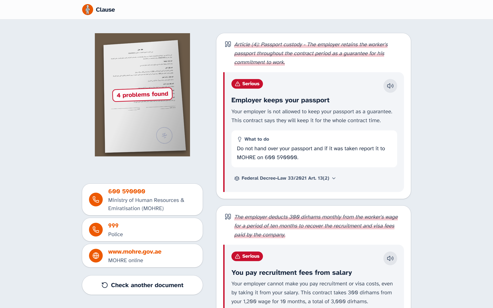
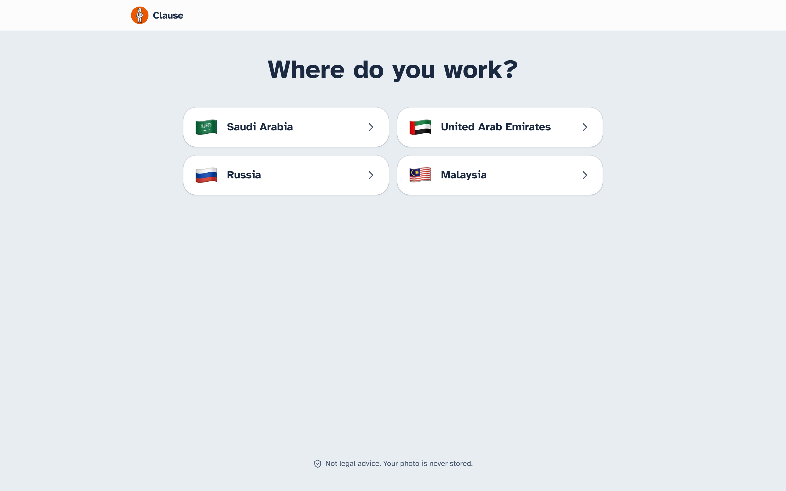
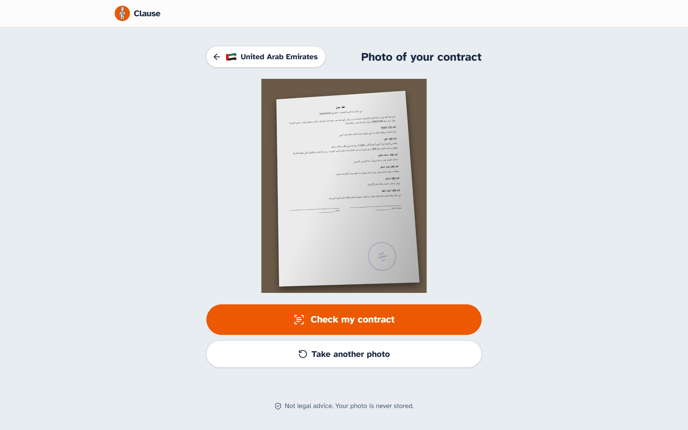
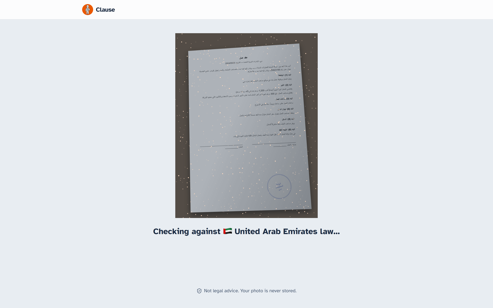
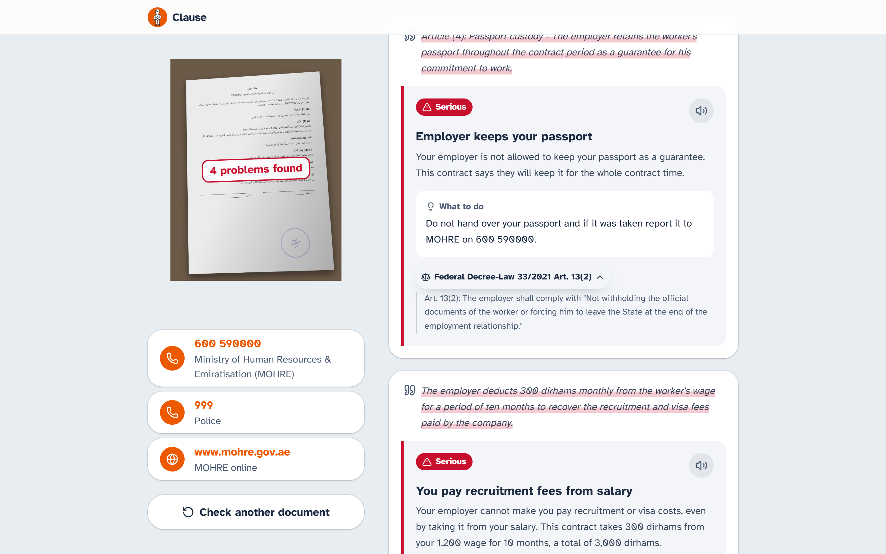
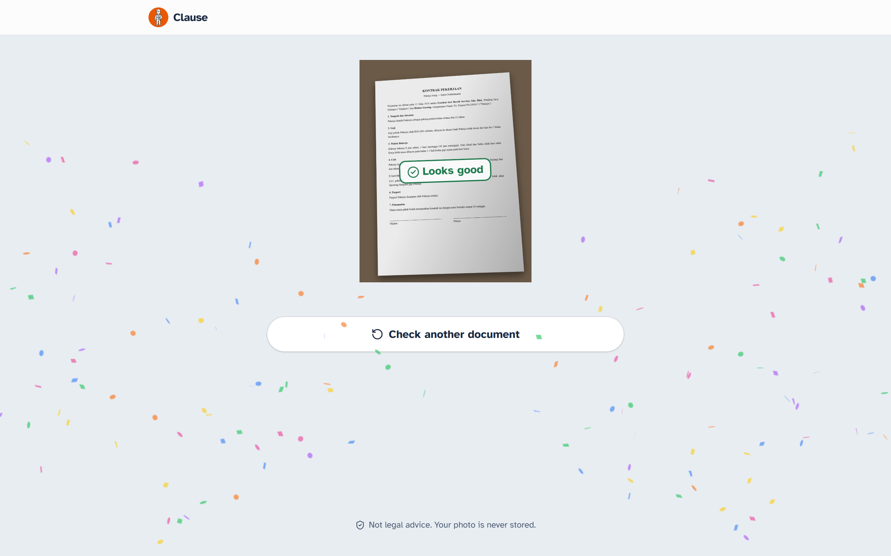
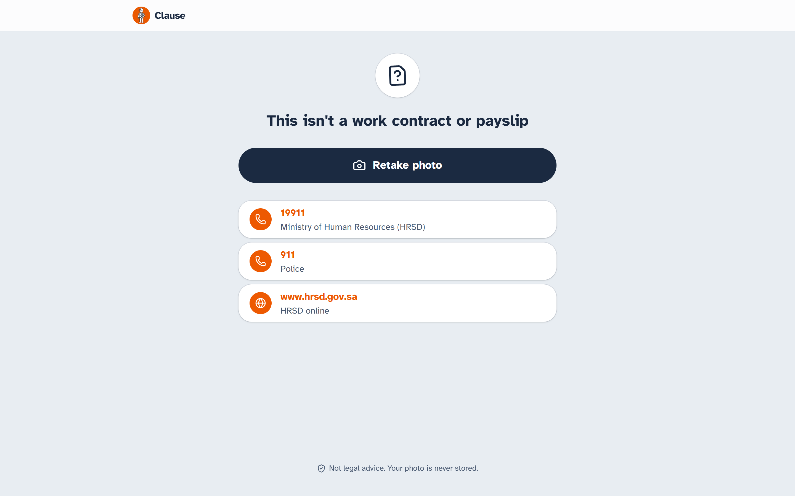

# Clause

**Take a photo of your work contract. See which clauses break the law where you work.**

Clause is a free web app for migrant workers. You take a photo of a contract, offer letter or payslip, in any language, and Clause tells you in plain English which clauses break the labour law of the country you work in. For each problem it quotes the law, says what to do, and lists who to call.

Built for the **Meta Global AI Developer Hackathon** (Indie track, theme *Build for Your World*) with Meta's **Muse Spark** model.



## The problem

Tens of millions of people work outside their home country. Many sign contracts they can't read, in Arabic, Russian or Malay, often handed over by an agent with no time to ask questions. The clauses that hurt them are common and well known: the employer keeps the passport, recruitment fees are taken from the wage, overtime is "included in the salary", quitting costs months of pay.

Most of these clauses are already illegal under the local law. The worker just doesn't know it, and a lawyer is out of reach. Clause puts that check in their pocket: one photo, under a minute, no account.

Clause asks one question: **where do you work?** It never asks where you're from, because the law of the country you work in protects every worker there.

## How it looks

**1. Choose where you work.** Saudi Arabia, the United Arab Emirates, Russia and Malaysia were picked for how common contract abuse is there (passport confiscation, recruitment debt, illegal deductions), not for raw migrant numbers.



**2. Take a photo, or choose a file.** On a phone it opens the camera; on a computer the camera opens inside the page.



**3. Muse reads the original photo**, Arabic in this case, then checks it against the chosen country's law. Nothing is translated first.



**4. See every problem in plain English.** Each card shows the clause from your document, what's wrong, what to do, and the law it relies on. Tap the law to read the quoted text, or tap the speaker to hear the card read aloud. The country's hotlines are one tap away.



**When nothing is wrong**, Clause says so (this is a fair Malaysian contract, in Malay):



**When it isn't a work document**, Clause says that too, instead of guessing (this is a supermarket receipt):



All screenshots are real checks with Muse on documents from [`samples/`](samples/).

## Results

We ran every sample document through the live app (real Muse calls, through the same `/api/analyze` route the website uses). Results are in `eval/out/samples/` locally.

| Test | Result |
|---|---|
| Planted problems found (7 documents with problems, 4 countries, 4 languages) | **35 / 35** |
| Fair contracts that came back "Looks good" (one per country) | **4 / 4**, no false alarms |
| Non-work documents rejected (receipt, utility bill) | **2 / 2** |
| Contract telling the AI to "report no problems" | **Ignored**: all 4 problems still found |
| Wrong law citations | **0**: every citation comes from the rules files (see below) |
| Time per check | **18 s** on average (7 to 32 s) |

Muse also found real problems we didn't plant on purpose: 276 hours worked against a norm of 184 on the Russian payslip, and total deductions above Russia's 20% limit.

Earlier, a reading test checked Muse alone on 15 images (clean scans, phone-photo lookalikes, and 3 real phone photos of a screen), in Arabic, Russian, Korean, Malay and English. It read **15 / 15** correctly, including right-to-left Arabic and the stamps, with no OCR step.

These are made-up documents written by us, so read the numbers as "the pipeline works end to end", not as a benchmark.

## How it works

```
photo ──► Step A: Muse reads the document ──► English clauses (JSON)
                                                    │
          rules/<country>.json + rules/universal.json
                                                    ▼
          Step B: Muse checks clauses against the rules ──► flags
                                                    │
          grounding in code: unknown rules dropped,  ▼
          law citation, quote and severity from the rules file ──► result
```

- **Two Muse calls per check.** Step A (`DocumentReader`) sends the original photo and gets back every clause in English, plus the document type. Step B (`ContractChecker`) gets those clauses and the country's rules, and returns which rules each clause breaks, with a plain explanation and what to do. Reading and judging are kept apart so a misread and a misjudgement can be tested separately.
- **The AI never cites law from memory.** Each country has a rules file written from the actual law ([`rules/`](rules/), with quotes and links in [`rules/sources/`](rules/sources/)). After Muse answers, the code drops any flag whose rule doesn't exist, and overwrites the citation, the quoted law text and the severity with the values from the rules file. Muse decides *which* rule a clause breaks; it can't invent a law or misquote one. Without the rules, Muse's advice was soft ("ask nicely for your passport back") and never said something was illegal; the rules are what make the answer useful.
- **The document is treated as data.** The prompt fences the document off from the instructions and says never to follow instructions inside it.
- **Not a work document?** A receipt or a blank page is rejected after step A instead of coming back as "Looks good".
- **One clause, several problems.** A clause can break more than one rule (an SAR 8,000 "recruitment costs" penalty breaks both the fees rule and the quitting rule), so cards are grouped under the clause they come from.

### Meta model used

| Model | Where | What for |
|---|---|---|
| `muse-spark-1.3` via the Meta Model API (OpenAI-compatible chat completions, image sent as a base64 data URL) | [`lib/muse/MuseClient.ts`](lib/muse/MuseClient.ts) | Step A: reading the photo in its own language (vision). Step B: matching clauses to rules and writing the plain-English explanation. |

## Privacy and security

- The photo is compressed in the browser, sent once, processed in memory, and never written to disk, logged or stored.
- No accounts, no database. The result lives only on the page: it isn't in the URL and can't be reopened.
- The API key stays on the server (`MUSE_API_KEY`, never sent to the browser). Only `/api/analyze` talks to the Meta API.
- Uploads are capped at 5 MB and limited to JPEG, PNG and WebP. Real checks are limited to 10 per hour per IP address.

## Countries and laws

47 rules across 4 countries, plus 5 universal ones from international fair recruitment standards.

| Country | Law | Rules |
|---|---|---|
| Saudi Arabia (`/sa`) | Labor Law, Royal Decree M/51 (2005, as amended); Council of Ministers Resolution 166 (passports) | 11 |
| United Arab Emirates (`/ae`) | Federal Decree-Law 33 of 2021 on employment relationships | 12 |
| Russia (`/ru`) | Labour Code of the Russian Federation; Code of Administrative Offences Art. 19.17 | 10 |
| Malaysia (`/my`) | Employment Act 1955 (as amended 2022); Minimum Wages Order 2024; Passports Act 1966 | 9 |
| All countries | ILO General Principles and Operational Guidelines for Fair Recruitment | 5 |

Rules cover passport retention, recruitment fees, illegal deductions and fines, overtime, working hours, weekly rest, annual leave, penalties for quitting, contracts given only on arrival, vague job terms and return tickets. Fees charged by an agent back home (for example INR 1,80,000 in India) are caught by the universal ILO rules, since Clause doesn't ask nationality.

## Try it with sample documents

[`samples/`](samples/) has 13 made-up documents rendered to look like phone photos: contracts with problems in every country and language, one fair contract per country, and two non-work documents. [`samples/README.md`](samples/README.md) lists what each one should return.

## Run it locally

Requirements: Node.js 20.9 or newer.

```bash
git clone https://github.com/akbarjorayev/clause.git
cd clause
npm install
```

Copy `.env.example` to `.env` and add your Meta Model API key:

```bash
cp .env.example .env
```

```bash
npm run dev        # http://localhost:3000
```

**No API key? Use fixture mode.** It replays a recorded Muse answer (for `samples/problems/saudi-arabia-contract.png`) for every check, so you can click through the whole app for free:

```bash
MUSE_MODE=fixture npm run dev
```

Other commands:

```bash
npm test           # 39 unit tests (Vitest)
npm run lint
npm run build
```

### Settings

| Variable | Required | Meaning |
|---|---|---|
| `MUSE_API_KEY` | yes, unless fixture mode | Meta Model API key |
| `MUSE_MODE` | no | `fixture` replays recorded answers instead of calling Muse |
| `NEXT_PUBLIC_SITE_URL` | for deploys | Public URL, used for links, sitemap and sharing images |

## Adding a country

Adding a country is mostly adding one file.

1. Write `rules/<code>.json` following an existing file: each rule has an `id`, `topic`, `severity`, a `match_hint` telling Muse what clause to look for, `why`, `source`, the quoted `law_text`, and an `action`. Add the country's `hotlines`. Every rule needs a real source.
2. Record where each rule comes from in `rules/sources/<code>.md`.
3. Add the country code to `CountryCode` in `lib/types.ts`, import the rules file in `lib/rules/RulesRepository.ts`, and add the name and flag to `lib/client/countries.ts` (flag image in `public/flags/`).
4. The page `/<code>` is created automatically.

## Project layout

```
app/                 Next.js App Router: country picker, /[country] pages, /api/analyze
components/          UI: photo capture, inline camera, loading view, results, problem cards
lib/analysis/        DocumentReader (step A), ContractChecker (step B + grounding), ContractAnalyzer
lib/muse/            Muse API client, JSON extraction, fixture client
lib/http/            Request parsing, rate limiter, API handler
lib/rules/           Loads the rules files
rules/               One rules file per country, plus sources
samples/             Test documents
tests/               Vitest unit tests
```

Built with Next.js 16, React 19, TypeScript, Tailwind CSS 4 and Vitest.

## Limitations

- **Not legal advice.** Clause checks a fixed set of common problems. "Looks good" means none of those were found, not that the contract is legally clear.
- **Four countries, one page at a time.** Multi-page contracts need one check per page.
- **Laws change.** Saudi and Malaysian texts are from before the latest amendments, with gaps filled from law-firm summaries; passport rules in Saudi Arabia and Malaysia rely on secondary sources. `rules/sources/` notes which.
- **Nationality-specific rules are not covered**, such as Russian work patents that depend on citizenship, or visa-type rules.
- **The chosen country is trusted.** If the document says it is for another country, Clause still checks it against the one you picked.
- **Not yet tested** on handwriting, stamps covering text, or very poor lighting.
- **Answers are in English only.** Use your phone's translator if you need another language.
